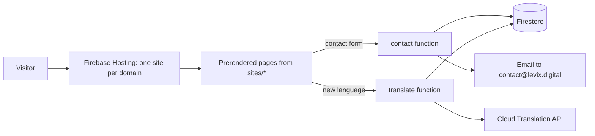

# Levix Digital Website: Technical Documentation

Entry point to the architecture of levix-digital-website. This index is maintained with the
`architecture-docs` skill: the sections between `architecture-docs` markers are
generated by `build_index.py`; the rest is written by hand.

## System Overview

The website is a set of statically prerendered sites built from one repository: the company home (`levix.digital`) and one site per product (`<product>.levix.digital`). Each site is a Vue 3 application prerendered by Vite and deployed to its own Firebase Hosting site. Shared packages hold the design system, the product facts and translation. Two Cloud Functions handle the contact form and on-demand translation, with Firestore as their only store. The product-wide requirements are in [TECH_SPEC.md](docs/product/TECH_SPEC.md).

## Subsystems

<!-- architecture-docs:subsystems:start -->
| Subsystem | Summary |
|---|---|
| [Backend Functions](docs/architecture/functions.md) | Cloud Functions for the contact form and the shared translation cache. |
| [Design System](docs/architecture/ui.md) | Ceramic and Aurora tokens, light and dark themes, shared layout, components and the 3D hero. |
| [Hosting](docs/architecture/hosting.md) | One Firebase project with a hosting site per domain, keyless deploys from the repository and a preview channel per pull request. |
| [Internationalization](docs/architecture/i18n.md) | English source strings, build-time French and Spanish bundles and on-demand languages cached in the browser. |
| [Product Content](docs/architecture/content.md) | One typed data file per product, the single source of the facts the sites show. |
| [Sites](docs/architecture/sites.md) | The company home and the product sites, each a prerendered Vite application deployed to its own Firebase Hosting site. |
<!-- architecture-docs:subsystems:end -->

## Architecture Decision Records

<!-- architecture-docs:adrs:start -->
| ADR | Title | Status | Version | Date |
|---|---|---|---|---|
| [ADR-0007](docs/adr/0007-keyless-deploys-with-workload-identity-federation.md) | Keyless deploys with Workload Identity Federation | accepted | v0.1.0 | 2026-10-30 |
| [ADR-0006](docs/adr/0006-tailwind-css-4-with-a-shared-stylesheet-theme.md) | Tailwind CSS 4 with a shared stylesheet theme | accepted | v0.1.0 | 2026-10-30 |
| [ADR-0005](docs/adr/0005-product-facts-as-typed-data-files.md) | Product facts as typed data files | accepted |  | 2026-10-30 |
| [ADR-0004](docs/adr/0004-build-time-and-on-demand-translation-without-per-language-ur.md) | Build-time and on-demand translation without per-language URLs | accepted |  | 2026-10-30 |
| [ADR-0003](docs/adr/0003-firebase-hosting-with-one-site-per-domain.md) | Firebase Hosting with one site per domain | accepted |  | 2026-10-30 |
| [ADR-0002](docs/adr/0002-vue-3-with-vite-static-prerendering.md) | Vue 3 with Vite static prerendering | accepted |  | 2026-10-30 |
| [ADR-0001](docs/adr/0001-modular-monolith-in-one-repository.md) | Modular monolith in one repository | accepted |  | 2026-10-30 |
<!-- architecture-docs:adrs:end -->

## How to Update This Documentation

- **A subsystem changed** (behavior, structure, data): edit its page in `docs/architecture/` in place, replacing outdated text.
- **A decision with alternatives and trade-offs**: create an ADR with `new_adr.py` and link it from the subsystem page.
- **A decision that reverses or corrects another**: create a new ADR with `--supersedes` or `--amends`; never rewrite an accepted ADR.
- **A feature was removed**: remove it from the subsystem page; its ADRs stay as history.
- **A release**: nothing here; release notes live in the GitHub releases.
- Run `check_docs.py` before committing.
