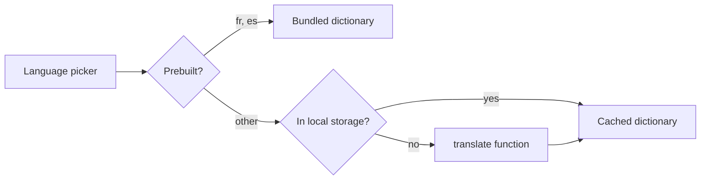

# Internationalization

English source strings, build-time French and Spanish bundles and on-demand languages cached in the browser.

## Responsibilities

Owns translation: the `t()` function, the English source dictionaries, the prebuilt French and Spanish bundles, the on-demand download of other languages, the browser cache and the chosen language. Does not own the translation backend (functions).

## Structure

`packages/i18n/src/` (`t()`, language state, cache, language list), `scripts/translate.ts` (build-time translation of new or changed strings), `sites/<site>/src/locales/{en,fr,es}.json`.

## Behavior

English is always complete. Prebuilt languages switch instantly. Another language is downloaded once from the `translate` function with a progress indicator, stored in local storage under a key that includes a hash of the English dictionary, and re-downloaded only for strings that changed. The URL never changes; right-to-left languages set the page direction. If the download fails, the page stays in English with a message.

## Interfaces

Used by every site and by ui components. Calls the `translate` function.

## Decisions

- [ADR-0004](../adr/0004-build-time-and-on-demand-translation-without-per-language-ur.md): build-time and on-demand translation without per-language URLs.
