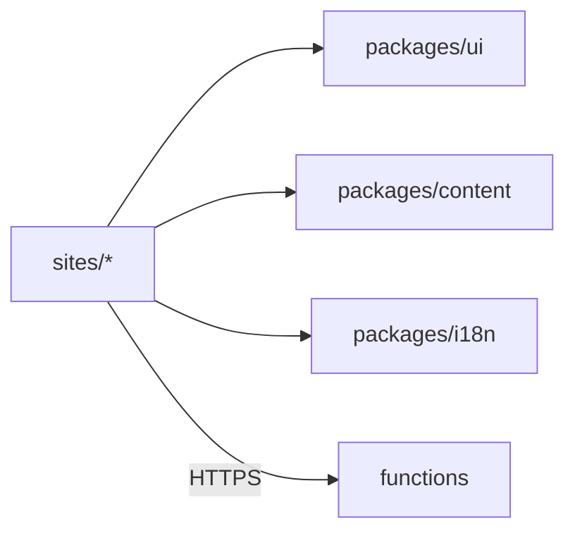

# Sites

The company home and the product sites, each a prerendered Vite application deployed to its own Firebase Hosting site.

## Responsibilities

Owns the pages of each site and their routes: the company home (`levix.digital`, including the research pages `/research` and `/research/lsie`, contact and legal pages) and one site per product (`anycontext`, `devcycle`, `gedo`, `aurora`). Does not own product facts (content), translations (i18n) or shared components (ui).

## Structure

`sites/<site>/` is a Vite application and an npm workspace named `@levix/site-<site>`: `src/pages/` (one file per route), `src/routes.ts` (the list of routes), `src/main.ts` (vite-ssg entry), `src/App.vue`, `src/styles.css` (imports `@levix/ui/styles.css`), `index.html`, `vite.config.ts` and its English strings in `src/locales/en.json`. Every site uses the same build configuration, `defineSiteConfig()` in `tooling/vite-site.ts` (Vue, Tailwind, prerendering, test settings); `tooling/` is build configuration, not a module.

## Behavior

Each site is prerendered to static HTML at build time and hydrated in the browser. A product site's pages are overview, features, plans and pricing, and download; when the product is not available, every page shows the availability banner and the download buttons are disabled. Each site builds into `sites/<site>/dist` and is deployed to its Firebase Hosting target.

Module boundaries are checked by lint (`eslint.config.js`, eslint-plugin-boundaries): a site imports a package only through its entry points (`src/index.ts`, and `src/styles.css` for `ui`), a package never imports a site and a site never imports another site. Packages are consumed from source through the `exports` map of their `package.json`; nothing is built or published. Type checking uses TypeScript 6 with vue-tsc, because vue-tsc does not run on TypeScript 7.

## Interfaces

Uses the public entry points of `packages/ui`, `packages/content` and `packages/i18n`, and calls the `contact` and `translate` functions over HTTPS.

## Decisions

- [ADR-0001](../adr/0001-modular-monolith-in-one-repository.md): one repository, one site per folder.
- [ADR-0002](../adr/0002-vue-3-with-vite-static-prerendering.md): Vue 3 with static prerendering.
- [ADR-0003](../adr/0003-firebase-hosting-with-one-site-per-domain.md): one Firebase Hosting site per domain.
