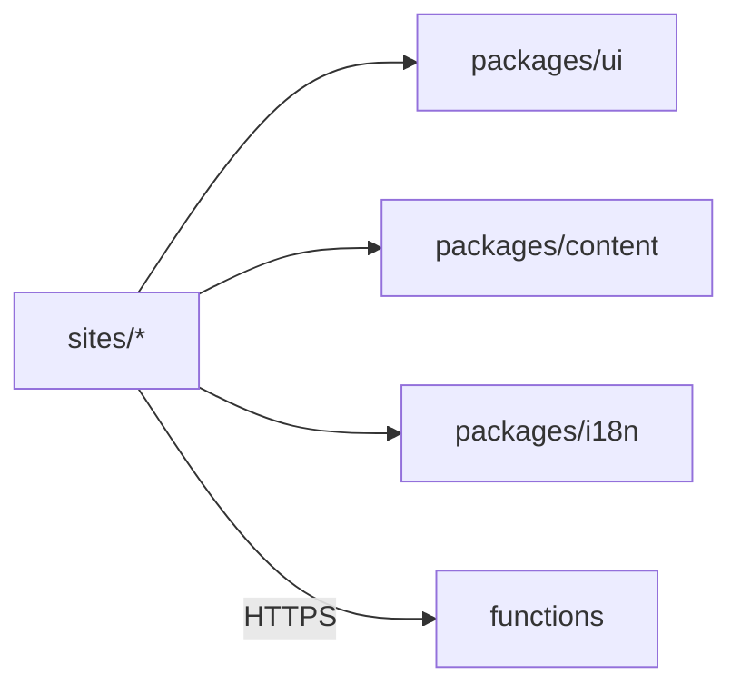

# Sites

The company home and the product sites, each a prerendered Vite application deployed to its own Firebase Hosting site.

## Responsibilities

Owns the pages of each site and their routes: the company home (`levix.digital`, including the research pages `/research` and `/research/lsie`, contact and legal pages) and one site per product (`docmapper`, `anycontext`, `devcycle`, `gedo`, `aurora`). Does not own product facts (content), translations (i18n) or shared components (ui).

## Structure

`sites/<site>/` is a Vite application and an npm workspace named `@levix/site-<site>`: `src/pages/` (one file per route), `src/routes.ts` (the list of routes), `src/main.ts` (vite-ssg entry), `src/App.vue` (wraps every page in the shared `SiteLayout` of `@levix/ui` with the site's id, the facts of `@levix/content` and the text of `@levix/i18n`), `src/styles.css` (imports `@levix/ui/styles.css`), `index.html`, `vite.config.ts` and, for the home, its English strings in `src/locales/en.json`. Every site uses the same build configuration, `defineSiteConfig()` in `tooling/vite-site.ts` (Vue, Tailwind, prerendering, test settings); `tooling/` is build configuration, not a module.

## Behavior

Each site is prerendered to static HTML at build time and hydrated in the browser. The company home is one page in five sections (`sites/home/src/pages/home/`): a static hero stating that Levix Digital builds products that run inside the customer's perimeter, the portfolio in two lines read from `@levix/content` (each product with its statement and a link to its site; availability is shown on the product sites), about, research (LSIE, paper in progress, no link yet) and contact (email and location). The home shows the company header and the product sites their own product header; the footer is the same on every site ([Design System](ui.md), Layout). A product site's home is `ProductIntro` from `@levix/ui` with the product of `productById('<site>')` and the release read while the site was built (`BUILD_RELEASE`): its name, statement and availability panel (download for available and preview products; for products in development the disabled button and the release candidate form). Each product site also prerenders `/subscription/confirm` and `/subscription/unsubscribe` (`SubscriptionPage.vue`, not indexed), which the signup emails link to. Features, plans and pricing, and download pages come with their own items. While a product site is built, the `releaseInfo` plugin of `tooling/vite-site.ts` (`tooling/release-info.ts`) reads its product's release once (with `GITHUB_TOKEN` when set; `RELEASES_API_BASE` points it to another API address for a local check), defines it as `__LEVIX_RELEASE__` (null on the dev server and in tests) and writes `/release.json`; a failure is a warning in the build log and gives no version ([ADR-0016](../adr/0016-release-information-read-at-build-time.md)). Each site builds into `sites/<site>/dist`, which the hosting target of the same name serves ([Hosting](hosting.md)).

Module boundaries are checked by lint (`eslint.config.js`, eslint-plugin-boundaries): a site imports a package only through its entry points (`src/index.ts`, and `src/styles.css` for `ui`), a package never imports a site and a site never imports another site. Packages are consumed from source through the `exports` map of their `package.json`; nothing is built or published. Type checking uses TypeScript 6 with vue-tsc, because vue-tsc does not run on TypeScript 7.

## Interfaces

Uses the public entry points of `packages/ui`, `packages/content` and `packages/i18n`, calls the `releaseSignup` function from the product sites, and will call the `contact` and `translate` functions, over HTTPS.

## Decisions

- [ADR-0001](../adr/0001-modular-monolith-in-one-repository.md): one repository, one site per folder.
- [ADR-0002](../adr/0002-vue-3-with-vite-static-prerendering.md): Vue 3 with static prerendering.
- [ADR-0003](../adr/0003-firebase-hosting-with-one-site-per-domain.md): one Firebase Hosting site per domain.
